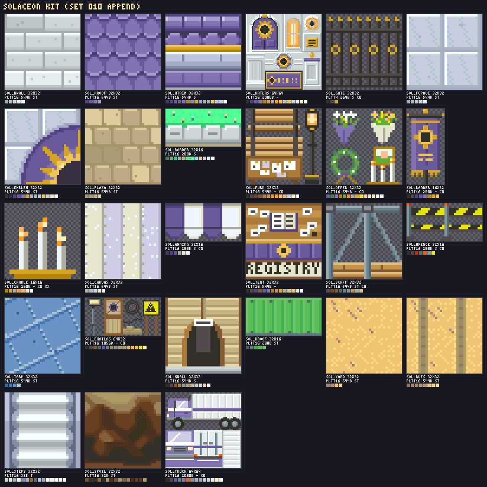
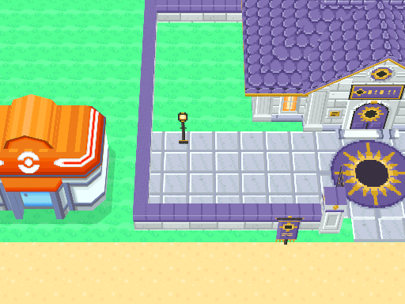

# Solaceon redesign: texture kit (textures workstream)

The kit holds 27 entries for set 010: 25 new textures and 2 palette-only recolours of stock set-010 texels. It is
built to look like it shipped with Platinum, and it fits the PLAN.md budget of +24 KB with about 9 KB to spare. This
workstream does **not** write set 010. `tools/solaceon_town/textures_kit.py` appends the kit, does a dry run by
default, and is for town-art to run with `--write`.



## 1. The stock look (set 010 and Solaceon's buildings)

`tools/solaceon_town/art/decode_stock.py` decodes set 010 at `50482f890` (63 textures, 60 palettes,
44544 + 1408 = 45952 B VRAM). It also decodes the building texture sets of four towns, which are the
areabm_texset of each town's area. It measures texel density on chunks 072/073 and on the stock buildings.
Contact sheet: [art/stock_set010_sheet.png](art/stock_set010_sheet.png).

**Set 010 holds terrain only.** Every Solaceon building (the Pokemon Center `pc`, the Mart `fs`, the house `t4_h01`,
the Day Care `t4_s01`, and their doors) is a map prop. Each prop takes its textures from **areabm_texset 6**
(39120 B), not from set 010, and a terrain material cannot bind a prop texture. A terrain Sanctuary hall therefore
needs its wall, roof and door textures in set 010. That is why the kit exists.

| area | town | map set | props list (building textures) |
|---|---|---|---|
| 0xA | Solaceon (also Celestic, R209/210/211E/215) | 010 | 6: pc, fs, t4_h01, t4_s01, r209s01 (Lost Tower), t5_* (Celestic), c4_h01a, ... |
| 0x8 | Eterna | 008 | 4: t3_h01, t3_s01, c4_s01..04, d2_s01/02 (Galactic bldg), d4_s01, ... |
| 0x9 | Hearthome | 009 | 5: c5_h01, c5_s01, c5_b01, c5_s03 (contest hall), c1_s03, ... |
| 0xB | Veilstone | 011 | 7: c7_h01, c7_s01..04, souko (warehouse), container, parabola/para_asi (dish truss), ... |

**Texel density.** Ground is 16 texels per tile everywhere, measured as 16.0 on ngrass, nsand, lgreen, nhana and
tshadow in 072/073. Cliff faces run 22 to 24 (criffp). House walls are 16 (t4_h01_a), with 14 to 25 on the PC and
Mart. Roof slopes are lower, 6 to 13, because the roof atlases are stretched. Building atlases are a single 64x64
per building, plus the shared `h_mado` (pltt4 window glass) and `h_kage` (pltt4 shadow, drawn translucent by its
material). **The kit uses 16 texels per tile throughout.** Small cards (windows, plaque, pilasters) land at 20 to 26.

**Palettes.** The overworld is very light and saturated. Grass is (82,255,148) and (74,246,139). The sand road is
(255,230,156) to (255,238,180). Paving (blueglay) is a lilac grey, (172,180,189) to (197,205,222). Building palettes
run darker. The houses share an outline pair: ink (49,49,41) and (82,74,74). Ground textures use only 3 to 10
colours. Building atlases use 13 to 16.

**Dithering.** Ground uses a sparse 2-tone checker between two close tones (blueglay is pure checker with a few 2x2
blots) plus small repeated motifs: ngrass tufts, nhana flowers. Building textures are **not dithered**. They use
flat fills with 1 px highlight and shadow lines.

**Outlines.** Building parts have no black outline around the silhouette. Ink appears only inside shapes: door and
window frames, joints, the dark under-roof line. Small terrain props such as the imped pickets have no outline at
all.

**How stock draws each part:**
- **Roofs:** rows of round or scalloped tiles 4 to 8 px tall. Each row has a dark line under the row above (t3_h01).
  Alternatively, flat bands with a highlight strip (pcloof, fsloof).
- **Walls:** flat panels with 1 px courses (t4_h01 logs, r209s01 Lost Tower stone with a carved relief and
  lilac/violet stripes).
- **Fences:** imped, white pickets 4 px wide on an 8 px pitch, 3 tones.
- **Paving:** blueglay / blueglayp, 16x16 / 32x32, low-contrast checker.
- **Steps:** newstep, 4 treads per 2 tiles, with wooden cheeks.

**Stock textures to reuse as-is** (already in set 010, no VRAM cost):
- ground: `ngrass`, `nsand` / `nsandp` (road + edge), `lgreen` / `lgreenp`, `tshadow`
- flower beds: `nhana`, `shana`, `rhana`, `plant2` (planter)
- garden of names grass: `l_grass_d/m/u` (tall grass) and `nhana`
- paving: `blueglay` / `blueglayp`
- fence: `imped` (the white picket fence plus rocks and bushes)
- steps: `newstep`
- cliffs and the Ruins hill: `criff`, `criffp`, `criffp2/3`, `wcliff`, `enccliff`
- cave mouth: `dhole`, `dhole_05`
- planks: `bridge` / `nbridge` (used on the scaffold decks in the mock)
- trees: `tree2_01`, `conttree*`, `g1_treea`
- shadow: `shadowchip`, a flat (65,65,74) that makes a cheap translucent building shadow with a material alpha of
  about 12

## 2. The kit

All colours come from stock palettes that Solaceon already shows: set 010 or the Solaceon / Eterna / Hearthome /
Veilstone building sets. `tools/solaceon_town/art/palette.py` names every colour and its source. Only five are
blends (palette.DERIVED): two violet shades for roof shadow and glint, the eclipse disc, its rim, and a corona
flash. The main sources:
- pale stone and lilac: the Lost Tower, `r209s01_a`
- violet: Eterna house walls, `t3_h01`
- gold: Veilstone containers
- wood: the Solaceon house `t4_h01_a` and the Day Care `t4_s01_a/c`
- warm light: the PC roof oranges
- steel: the Veilstone dish truss
- plaza: Hearthome beige, `c5_s03_a`

`sol_steps` and `sol_spoil` are stock set-010 texels (`newstep`, `criffp`) with new palettes. That is the memorial
wall's blueglay -> sol_stone trick, and each costs 24 to 32 B.

Bytes are as `textures_kit.py` builds them: palettes are trimmed to the highest index each texture uses, the same as
`nsbtx.encode_texture`. `paint_kit.py` prints the conservative 32 B per palette figure, 15304 B in total.

| texture | group | format | size | frames | texel B | pal B | repeat | c0 | what / UV rule (16 texels per tile) |
|---|---|---|---|---|---|---|---|---|---|
| sol_hwall | hall | pltt16 | 32x32 | 1 | 512 | 16 | s t | 0 | pale ashlar, 16x8 blocks; hall walls and the compound wall |
| sol_hroof | hall | pltt16 | 32x32 | 1 | 512 | 16 | s t | 0 | violet round tiles, rows along s; v down the slope, 2 tiles per repeat |
| sol_htrim | hall | pltt16 | 32x32 | 1 | 512 | 32 | s | 0 | 4 bands of 8 px (0.5 tile): v 0-.25 ridge cap, .25-.5 eave tile ends over a gold fascia, .5-.75 lilac plinth, .75-1 violet coping |
| sol_hatlas | hall | pltt16 | 64x64 | 1 | 2048 | 32 | - | 0 | double door with eclipse (0,0 32x32 = 2x2 tiles); arched lit window (32,0 16x32); oculus (48,0); plaque (48,16); pilaster (0,32 16x32: capital rows 0-7, shaft 8-23 may stretch, base 24-31); gable medallion (16,32 32x16); sign board (16,48 32x16); gate post (48,32 16x32) |
| sol_gate | hall | pltt4 | 32x32 | 1 | 256 | 8 | s | 1 | iron bars, gold spear tips and rings, see-through; gate leaves or railings |
| sol_steps | hall | pltt16 | (newstep 32x32) | 1 | 0 | 24 | t | 0 | **palette only**: stock newstep + palette sol_steps (pale stone treads, lilac cheeks) |
| sol_fcpave | forecourt | pltt16 | 32x32 | 1 | 512 | 16 | s t | 0 | forecourt flags, one per tile, blueglay-style checker |
| sol_emblem | forecourt | pltt16 | 32x32 | 1 | 512 | 32 | s t + **flip** | 0 | quadrant of the 4x4-tile eclipse (dark disc, gold ring, violet corona, 16 gold rays); material repeat+flip s/t, UV 0..2 over the 4x4 tiles |
| sol_plaza | plaza | pltt16 | 32x32 | 1 | 512 | 16 | s t | 0 | warm beige setts, 4 per tile, running bond |
| sol_border | plaza | pltt16 | 32x16 | 1 | 256 | 32 | s | 0 | garden-of-names edge strip 2x1 tiles: grass + flowers (v 0), kerb stones with name lines, kerb shadow (v 1) |
| sol_furn | plaza | pltt16 | 32x32 | 1 | 512 | 32 | - | 1 | bench side (0,0 24x12 = 1.5x0.75 t), bench top (0,12 24x8), memorial card board (0,20 24x12), lantern post with lit lamp (24,0 8x32 = 0.5x2 t) |
| sol_offer | plaza | pltt16 | 32x32 | 1 | 512 | 32 | - | 1 | four 1x1 cards: lilies in violet paper, posy, wreath on easel, lit candles before a photo |
| sol_banner | plaza | pltt16 | 16x32 | 1 | 256 | 24 | - | 1 | violet Eclipse banner on its post, card 1x2 tiles |
| sol_candle | plaza | pltt16 | 16x16 | 3 | 128 | 16 | - | 1 | candle dish card; frames sol_candle.1..3 for fldtanime (6 VBlanks per frame) |
| sol_canvas | tent | pltt16 | 32x32 | 1 | 512 | 16 | s t | 0 | cream / pale-lilac pilgrim canvas, 2 panels per tile |
| sol_awning | tent | pltt16 | 32x16 | 1 | 256 | 16 | s | 1 | violet/cream striped valance, scalloped see-through lower edge |
| sol_tent | tent | pltt16 | 32x32 | 1 | 512 | 32 | - | 0 | table top with name cards and the open registry ledger (v 0-.5), front cloth with eclipse (.5-.75), REGISTRY board (.75-1) |
| sol_scaff | excavation | pltt16 | 32x32 | 1 | 512 | 24 | s t | 1 | scaffold face: a standard per tile, ledger, X brace, plank deck + toe board, see-through |
| sol_wfence | excavation | pltt16 | 32x16 | 1 | 256 | 16 | s | 1 | warning fence, yellow/black rails, red caps, see-through |
| sol_tarp | excavation | pltt16 | 32x32 | 1 | 512 | 16 | s t | 0 | blue tarp with folds |
| sol_exatlas | excavation | pltt16 | 64x32 | 1 | 1024 | 32 | - | 1 | work light (0,0 16x32), crate side / top (16,0 / 16,16), cable coil (32,0), cable run (32,16 16x8), sandbags (32,24), KEEP OUT board (48,0 16x32) |
| sol_spoil | excavation | pltt16 | (criffp 32x32) | 1 | 0 | 32 | s t | 0 | **palette only**: stock criffp + palette sol_spoil (raw-earth browns): pit face, spoil heap |
| sol_kwall | ranch | pltt16 | 32x32 | 1 | 512 | 24 | s | 0 | kennel front: Day Care boards, one arched kennel + name plate per 2 tiles, concrete footing; rows 0-8 alone = plain boards for sides |
| sol_kroof | ranch | pltt16 | 32x16 | 1 | 256 | 16 | s t | 0 | corrugated sheet in the Day Care roof green, ridges down the slope (t) |
| sol_yard | ranch | pltt16 | 32x32 | 1 | 512 | 16 | s t | 0 | packed yard dirt (darker than the road) |
| sol_ruts | ranch | pltt16 | 32x32 | 1 | 512 | 24 | s t | 0 | yard lane 2 tiles wide: same dirt, two tyre ruts 1 tile apart along t |
| sol_truck | ranch | pltt16 | 64x64 | 1 | 2048 | 32 | - | 1 | parked truck: side with cab + box + wheels (0,0 64x32 = 4.25x2 t), cab front (0,32 24x24), rear doors (24,32), box roof (48,32 16x32), cab roof (0,56), bonnet (24,56) |
| **total** | | | | | **14464** | **624** | | | **15088 B** |

**VRAM:** set 010 goes from 45952 B to **61088 B** (+15136 B with alignment; texels 44544 -> 59008, palettes
1408 -> 2080). The budget is +24576 B, and the set stays below the 76416 B proven ceiling of set 048. The set grows
from 63 to 88 textures and from 60 to 87 palettes. For scale: Solaceon's building textures, areabm_texset 6, take
another 39120 B in the same texture VRAM bank.

**Stretch items, cut first** (`textures_kit.STRETCH`): sol_truck 2080 B, then sol_ruts 536 B, sol_candle 144 B
(fldtanime), sol_tarp 528 B and sol_border 288 B. Cutting all five saves about 3.6 KB. After those, sol_hatlas is
the biggest single item. Its regions could drop to 32x64, losing the gate post and the sign, which saves about
1 KB.

### Material rules for town-art

- Map materials as stock: lit (`poly_attr 0x001f8081`), back-face culled. The see-through c0 textures (gate, scaff,
  wfence, awning, furn, offer, banner, candle, exatlas, truck) want `cull none` where both sides show.
  - The kit bakes light only into small accents: lit window glass, lamps, candle flames, the gold flash. It all
    follows the area light like stock.
- **Emblem:** the material for sol_emblem needs repeat **and flip** on s and t (`make_material(..., flip=(True,
  True))`). Map UV 0..2 over the 4x4 tiles, which centres the disc on the tiles' shared corner. The emblem's outer
  flags sit on its own tile grid. Its centre is on the door axis (a 9-wide hall puts the door tile at x+4, so the
  disc centre is at a tile *centre*). When that happens, offset the sol_fcpave UV by half a tile
  (`u = (x - x_emblem0) / 2`) so the flags line up, as the mock does.
- **Palette-only entries:**
  - `sol_steps`: texture `newstep`, palette `sol_steps`
  - `sol_spoil`: texture `criffp`, palette `sol_spoil`
- Bands (sol_htrim, sol_tent, sol_kwall rows) are picked by v range; keep a 1/64 inset at band edges to avoid
  bleeding into the next band.
- **sol_candle animation:** append a fldtanime entry the way `build_art.py` / `tools/coronet_lava/add_lava_anim.py`
  do. Use texture name `sol_candle`, frames `sol_candle.1..3` (all three share one palette and index layout) and
  6 VBlanks per frame. Without the entry, the candle shows frame 1, still.
- **Tent orientation:** the field camera looks north at 55 degrees, so an open side only reads if it faces south. A
  table under a valance is hidden unless the valance bottom is at least about 1.4 tiles up and the table sits near
  the front (see the mock).

## 3. Previews

All previews are in `/tmp/Solaceon Update/textures/`. `~/Documents` cannot be written from these sessions;
`common.preview_dir()` uses `$SOL_PREVIEW_DIR` or `~/Documents/Solaceon Update/textures` when writable.

| file | what |
|---|---|
| `stock_set010_sheet.png`, `stock_set010_palettes.png`, `stock_set010/` | stock set 010, labelled, PNG + JSON per texture |
| `stock_props_{solaceon,eterna,hearthome,veilstone}_sheet.png` + dirs | stock building textures of those towns |
| `stock_density.txt` | density and extent table, area / props lists |
| `kit_sheet.png`, `kit_table.txt` | the kit, labelled |
| `kit_from_set/` | the kit decoded back out of the built set (`textures_kit.py --preview`); identical to the assets |
| `render/street_game.png` | **mock street**: the stock Pokemon Center beside the graybox Sanctuary hall wearing the kit |
| `render/hall_game.png` | hall front, forecourt emblem, compound wall, gate posts, open gate, banners, lanterns |
| `render/plaza_game.png` | memorial plaza: setts, benches, lanterns, card board, offerings, candles, garden of names with border |
| `render/tent_game.png` | registration tent (open front, table with ledger and cards, REGISTRY board) |
| `render/dig_game.png` | excavation: stock cliff and cave mouth, scaffold, warning fence, work lights, KEEP OUT, tarp pile, crates, cable, spoil heap |
| `render/ranch_game.png` | kennel block (green corrugated roof), yard and ruts, the truck |
| `render/street_top.png` | the whole mock from above, 16 px per tile |
| `render/street_lit_game.png`, `render/hall_lit_game.png` | the same with a sun (`--lit`) |

Copies in this repo: [art/street_game.png](art/street_game.png), [art/hall_game.png](art/hall_game.png),
[art/street_top.png](art/street_top.png). The game-camera renders are at half size.



**The mock** (`preview_kit.py`) is a test scene, not the town layout. The hall is 9x5 tiles (x 21..30, z 2.5..7.5)
with 2.5-tile walls and a hip roof ridged at 4.0. A front bay x 23..28 has 3.0-tile walls and a gable to 4.75. That
makes the hall about 4 tiles tall next to the Pokemon Center's 3.9. The bay holds the 2x2 door, the sign board above
it and the medallion in the gable. Pilasters are 0.75 tiles wide; windows are 0.8 x 1.55. The stock PC (prop 4 + door
70) and a Solaceon house (197 + door 246) are placed with the same prop offsets as in chunk 072, using their stock
textures. Every kit texture appears in the mock (the script checks this).

## 4. Rerun

```
python3 tools/solaceon_town/art/decode_stock.py          # stock sheets, density (about 5 s)
python3 tools/solaceon_town/art/paint_kit.py --sheet     # paints + exports tools/solaceon_town/assets/textures/
python3 tools/solaceon_town/textures_kit.py              # dry run: checks, table, VRAM (writes nothing)
python3 tools/solaceon_town/textures_kit.py --preview "/tmp/Solaceon Update/textures/kit_from_set"
python3 tools/solaceon_town/art/preview_kit.py [--lit] [--views street,hall,plaza,tent,dig,ranch,top]
# town-art, when applying the kit:
python3 tools/solaceon_town/textures_kit.py --write      # refuses if any check fails
```

- Everything is standard-library Python. The paint scripts are deterministic (seeded), and re-running gives
  byte-identical PNGs.
- `preview_kit.py` runs Blender through `art/blender_cpu.py`, which is `blender_preview.py` on Cycles CPU. EEVEE
  needs Metal shader compilation, and that crashes in sandboxed sessions. It needs a session where Blender may run
  unsandboxed.
- `textures_kit.SET_REL` is the one place the output path lives. On the macOS app branch (`solaceon-mac`), set 010
  is `res/field/mapmodels/texture_sets/map_texture_set_010.nsbtx`; the bytes are identical.

## 5. Open questions

- **Platinum feel** (judged from renders only, not on hardware):
  - The forecourt emblem is large and bright. It is the plan's centrepiece, but at 4x4 tiles of saturated violet
    and gold it is the loudest thing on screen. A 3x3 version or a duller corona (violet3 instead of gold rays) is a
    one-line change.
  - The violet roof is a regular scallop pattern with no baked gradient. Stock roofs bake a light-to-dark band into
    the atlas, and lighting does part of that work here.
  - The truck is new territory: Sinnoh towns have no parked vehicles. It reads as a box truck, but it is a stretch
    item.
- Not checked in game: the flip material on sol_emblem, the fldtanime entry for sol_candle, and the night look of
  the baked warm accents.
- Banners: the moving Eclipse banners are object events. `sol_banner` should match their colours, but I have not
  compared it against the object sprite.
- The hall here is a graybox of my own. Its real footprint, heights and door tile come from the town-layout
  workstream, and the UV rules above work for any layout.
